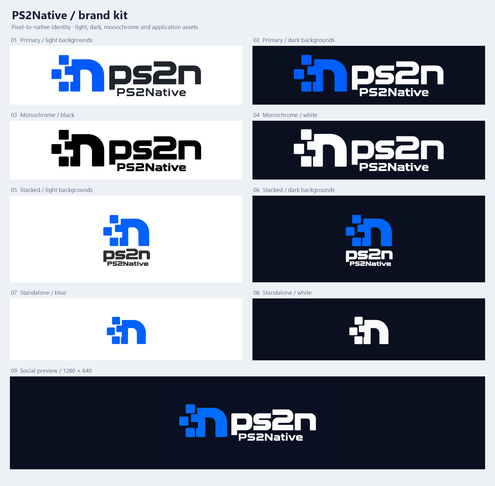

# Brand assets

The PS2Native logo is an emblem, three square pixels that resolve into a
lowercase n, beside the `ps2n` wordmark. **PS2Native** is the project's name
and **ps2n** its short name, used for the command line and for file and
symbol prefixes.



## Files

| File | Use |
|---|---|
| `logos/ps2native-horizontal-light.png` | The logo for light backgrounds: blue emblem, graphite text. |
| `logos/ps2native-horizontal-dark.png` | The logo for dark backgrounds: blue emblem, white text. |
| `logos/ps2native-horizontal-black.png` | One colour, black, for light backgrounds. |
| `logos/ps2native-horizontal-white.png` | One colour, white, for dark backgrounds. |
| `logos/ps2native-stacked-light.png`, `logos/ps2native-stacked-dark.png` | The emblem above the wordmark, for square spaces. |
| `icons/ps2native-icon-blue-<size>.png` | The emblem alone, in blue: avatars, application icons, favicons. |
| `icons/ps2native-icon-white-<size>.png` | The emblem alone, in white, for dark backgrounds. |
| `icons/favicon.ico` | The blue emblem at 16, 32, 48 and 256 px. |
| `social/ps2native-social-1280x640.png` | The repository's social preview: the dark logo on navy, opaque. |
| `BRAND-OVERVIEW.png` | The variations side by side (above). |
| `PROMPTS.md` | The prompts the images were generated from. |

The horizontal logos share one 1455 × 453 canvas, so switching between them
moves nothing. The stacked logos are 1254 px square. The icons come in 16,
32, 48, 64, 128, 180, 192, 256, 512 and 1024 px. Use 512 px for an avatar,
180 px for a touch icon, and 192 and 512 px for a web app manifest. At 16 px
the three squares lose their detail, so use 32 px or more where there is
room.

## Where the project uses them

- The README's heading shows the light or the dark logo, following the
  reader's colour scheme.
- On Windows, `ps2n.exe` and every program linked with the runtime carry
  `favicon.ico`, through `assets/ps2n.rc`. Explorer shows it, and SDL puts it
  on the game window. On other platforms the window has the system's default
  icon.
- The social preview is set on GitHub (Settings, General, Social preview),
  not from a file in the repository.

## Rules

- Keep the aspect ratio.
- Leave at least the width of one of the emblem's squares clear around the
  logo.
- Show the horizontal logo at least 280 px wide. Below that, use the emblem
  alone.
- On dark backgrounds use the dark, white or stacked dark versions. On light
  backgrounds use the light, black or stacked light ones.
- Keep the alpha channel. Transparent pixels still hold colour, which a
  viewer that ignores alpha shows as a halo. Correct compositing hides it.
- These are PNG files, not vector artwork. Scale them down, never up, and
  make a new size from the largest file rather than from a smaller one.

In Markdown, this picks the version for the reader's colour scheme. The paths
are relative to the repository's root, as in README.md:

```html
<picture>
  <source media="(prefers-color-scheme: dark)" srcset="assets/branding/logos/ps2native-horizontal-dark.png">
  
</picture>
```

## Origin

The images were generated with an image model. One logo was chosen, and
every variation is an edit of it ([PROMPTS.md](PROMPTS.md)). The sizes, the
trimmed margins and the ICO file were made from those images without further
changes. The generated masters, with their original padding, are not in the
repository.
