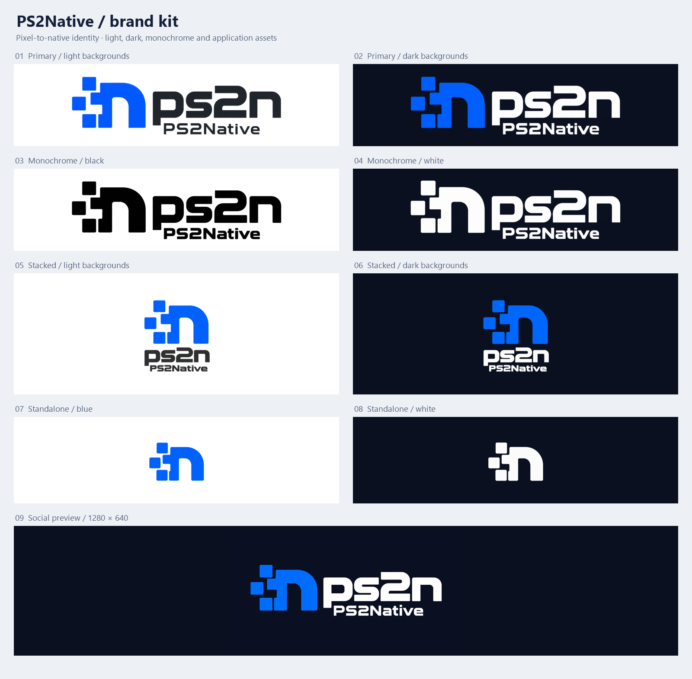

# Brand assets

The PS2Native logo is an emblem, three square pixels that resolve into a
lowercase n, beside the `ps2n` wordmark. **PS2Native** is the project's name
and **ps2n** its short name, used for the command line and for file and
symbol prefixes.



## Files

| File | Use |
|---|---|
| `logos/ps2native-horizontal-light.png` | The logo for light backgrounds: blue emblem, graphite text. |
| `logos/ps2native-horizontal-dark.png` | The logo for dark backgrounds: blue emblem, white text. |
| `logos/ps2native-horizontal-black.png` | One colour, black, for light backgrounds. |
| `logos/ps2native-horizontal-white.png` | One colour, white, for dark backgrounds. |
| `logos/ps2native-stacked-light.png`, `logos/ps2native-stacked-dark.png` | The emblem above the wordmark, for square spaces. |
| `icons/ps2native-icon-blue-<size>.png` | The emblem alone, in blue: avatars, application icons, favicons. |
| `icons/ps2native-icon-white-<size>.png` | The emblem alone, in white, for dark backgrounds. |
| `icons/favicon.ico` | The blue emblem at 16, 32, 48 and 256 px. |
| `social/ps2native-social-1280x640.png` | The repository's social preview: the dark logo on navy, opaque. |
| `BRAND-OVERVIEW.png` | The variations side by side (above). |
| `PROMPTS.md` | The prompts the images were generated from. |

The horizontal logos share one 1455 × 453 canvas, so switching between them
moves nothing. The stacked logos are 1254 px square. The icons come in 16,
32, 48, 64, 128, 180, 192, 256, 512 and 1024 px. Use 512 px for an avatar,
180 px for a touch icon, and 192 and 512 px for a web app manifest. At 16 px
the three squares lose their detail, so use 32 px or more where there is
room.

## Colours

For anything drawn to go with the logo: a window, a page, a diagram. The
values were measured from the files, as the median of their opaque pixels
(alpha of 250 or more). The files are generated images, so the same colour
differs a little from one to the next; the table gives the value to use and
where it was measured.

| Colour | Value | Measured in |
|---|---|---|
| Blue, the emblem | `#0060FC` | The icon (`#0060FB`) and the stacked logo (`#0060FC`). The horizontal logos have `#0058FD` and `#005FFD`, the social preview `#006DFE` |
| Graphite, the text on light backgrounds | `#1E232B` | The horizontal light logo. The stacked light logo has `#2C2D2E` |
| White, the text on dark backgrounds | `#FFFFFF` | The horizontal dark logo (`#FEFEFE`) |
| Navy, the dark background | `#0A1022` | The social preview |

## Where the project uses them

- The README's heading shows the light or the dark logo, following the
  reader's colour scheme.
- On Windows, `ps2n-recomp.exe` and `ps2n-host.exe` carry `favicon.ico`,
  through `assets/ps2n.rc`. Explorer shows it. The host has no window yet;
  the one it gets takes the same icon, which is resource 1 of the
  executable. Nothing is done for other platforms yet.
- The social preview is set on GitHub (Settings, General, Social preview),
  not from a file in the repository.

## PCSX2's logo and look

PS2Native runs a game on PCSX2's core and says so: in its documentation, in
the license notices and in its logs. That is attribution and stays. PCSX2's
logo is another matter. It is not shown as ours, and ours is not put on
PCSX2's interface
([ADR 0012](../../docs/adr/0012-ps2native-branding-not-pcsx2s.md)):

- The build leaves PCSX2's three logo files out of the resources it copies
  beside the host (`host/targets.cmake`).
- The host never opens PCSX2's own interface, the only part of the core that
  draws them.
- The messages the core can draw over a game's picture have PCSX2's look,
  which is written into its code. A finished game shows none of them: they
  are switched off by settings, and PCSX2 is not patched to restyle them.
  While a game is being brought up they may be on, as PCSX2 draws them.
  Nothing shows them today, because the host has no window.

## Rules

- Keep the aspect ratio.
- Leave at least the width of one of the emblem's squares clear around the
  logo.
- Show the horizontal logo at least 280 px wide. Below that, use the emblem
  alone.
- On dark backgrounds use the dark, white or stacked dark versions. On light
  backgrounds use the light, black or stacked light ones.
- Keep the alpha channel. Transparent pixels still hold colour, which a
  viewer that ignores alpha shows as a halo. Correct compositing hides it.
- These are PNG files, not vector artwork. Scale them down, never up, and
  make a new size from the largest file rather than from a smaller one.

In Markdown, this picks the version for the reader's colour scheme. The paths
are relative to the repository's root, as in README.md:

```html
<picture>
  <source media="(prefers-color-scheme: dark)" srcset="assets/branding/logos/ps2native-horizontal-dark.png">
  
</picture>
```

## Origin

The images were generated with an image model. One logo was chosen, and
every variation is an edit of it ([PROMPTS.md](PROMPTS.md)). The sizes, the
trimmed margins and the ICO file were made from those images without further
changes. The generated masters, with their original padding, are not in the
repository.

The files came from the previous project (`ps2-uncompiler`, `assets/`) on
2026-11-11, copied byte for byte. Only this README and the comment in
`assets/ps2n.rc` were changed, to say where this project uses them.
